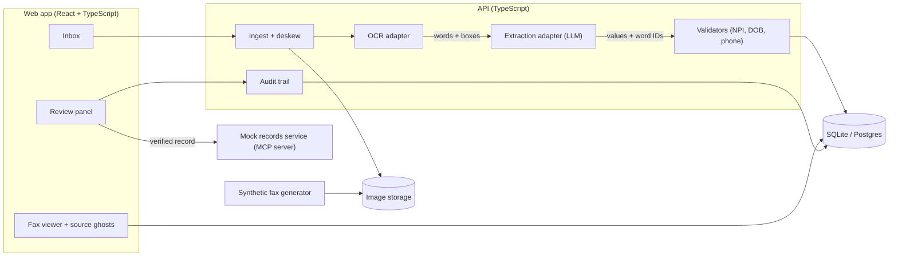

# Facsimortis: Design

Stack choices below are proposals. Change them if the first-hour runtime proof says otherwise.

## Architecture



## Key design decision: sources come from OCR, not from the model

The model never draws boxes. The pipeline is:

1. OCR returns every word with an ID and a bounding box.
2. The model receives the word list and returns, per field, the value and the word IDs it used. It returns no confidence. Our code rejects the reply unless every cited ID exists, no ID repeats, a null value cites nothing, and the value equals the cited words' OCR text joined by single spaces. An invalid reply gets one retry, then the fax is marked needs-review. Field confidence is the lowest OCR confidence among the cited words.
3. The UI draws each source ghost from those word IDs.

This makes the highlight honest: if the model cites words that are not on the page, validation rejects the field. That check is the core "runtime proof" to build first.

Considered and not chosen: the model returns word IDs only and our code builds the value by joining the cited words. The exact-match check gives the same guarantee, because the value can only be the cited words' text, and it keeps the reply readable.

## Components

| Component | Responsibility | Notes |
|---|---|---|
| Ingest | Accept file, deskew, normalise to PNG | Reject over 10 MB |
| OCR adapter | Return `{id, text, box}[]` | One interface, two implementations (cloud OCR, local fallback) so the demo never depends on one service |
| Extraction adapter | Return `Field[]` with word IDs | Strict JSON schema, retry once on invalid JSON |
| Validators | NPI check digit, DOB range, phone format | Pure functions, property-tested |
| Audit trail | Original value, edits, verifier, timestamps | Append-only |
| Generator | Build synthetic faxes with controlled degradation | Seeded, so tests are repeatable |
| Mock records service | Receives verified records | Exposed as an MCP server so Kiro can test the write path |

## Data model

```ts
type Word = { id: string; text: string; box: [number, number, number, number] }

type Field = {
  name: 'patientName' | 'dob' | 'referringProvider' | 'npi' | 'reason' | 'urgency' | 'callbackPhone'
  value: string | null
  wordIds: string[]
  confidence: number        // 0..1
  flags: string[]           // plain-language reasons, empty when clear
  reviewed: boolean
}

type FaxRecord = {
  id: string
  receivedAt: string
  status: 'received' | 'processed' | 'needs-review' | 'verified'
  fields: Field[]
  words: Word[]
}
```

## Flagging rules

A field is flagged when its value is null, when any validator fails, or when its cited word IDs do not exist or do not contain the value.

The 0.85 confidence threshold was an initial guess and is not used yet. The Phase 0 measurements showed that OCR confidence alone cannot separate misreads from correct words. The threshold, and any other flagging signals, are chosen in task 1.2 on the evaluation set, using hold-out seeds. The source highlight plus human review is the final safeguard.

## UI

- **Inbox:** fax thumbnails with a flagged-field count.
- **Viewer:** the fax image with source ghosts. Selecting a field pulses its ghost.
- **Review panel:** flagged fields first, one-click accept, inline edit, single "Verify record".
- **Visual language:** ghost effects only where they carry meaning (source ghosts, dial-tone loading, "laid to rest" on verify). Dark theme, AA contrast, full keyboard use.

## Testing

- **Property-based tests (fast-check):** NPI validator accepts every valid number and rejects any single-digit change; DOB validator never accepts future dates; word-ID citations always resolve to the cited value.
- **Evaluation set:** generator builds N faxes at several degradation levels; report field accuracy per level. This number goes in the demo.
- **Kiro hook:** on any change to extraction code, re-run the evaluation set and fail if accuracy drops.

## How each Kiro feature earns its place (for the write-up)

| Feature | Concrete job |
|---|---|
| Specs | These requirements drive the build; tasks trace back to R1 to R10 |
| Steering | `product.md` (persona, synthetic-only rule), `tech.md` (adapter pattern, strict schemas), `design.md` (ghost language rules) |
| Hooks | Re-run evaluation on extraction changes; check that `.kiro` is not in `.gitignore`; lint fixtures |
| MCP | Mock records service for the write path; docs lookup for OCR and schema libraries |
| Property-based testing | Validators and citation integrity |
| Custom agent | A "fax-qa" agent that generates hard faxes and reports misses |

Record real before/after observations for each row as you build. Judges reward specifics, not claims.

## Risks

- OCR quality on heavy noise. Mitigation: generator levels, deskew, local fallback.
- Model cites wrong words. Mitigation: citation validation (see key decision).
- Scope creep. Mitigation: anything not in the demo script is cut.
